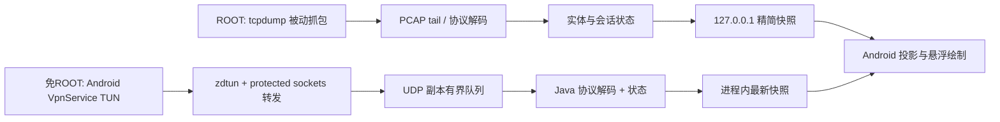

# 从零实现 UDP 屏幕 ESP

这里记录协议分析、实现和排错过程。运行见 [BUILD.md](BUILD.md)；字段和公式见 [PROTOCOL.md](PROTOCOL.md)。这里的“纯 UDP”是游戏动态状态只来自被动 UDP；离线代码/资源分析可以提供固定规则。root 版的 loopback HTTP 只是本机后端到绘制层的通信。

本项目针对固定版本 `1.35.20.001`、`gameplay_type=12 / gameplay_id=1201`；版本变化后必须重新核实协议和镜头规则。源码不是任意 Unity 游戏的通用 ESP。

## 1. 确定显示内容和数据来源

目标是在当前游戏画面叠加目标、距离、方框、射线与已上报 HP；无需用户输入 FOV、眼高、距离、分辨率或视角模式。显示位置需要落在游戏画面上，而不是另画一张俯视地图。

划分三类输入：

| 输入 | 来源 | 核对方法 |
|---|---|---|
| 实体坐标、身份、视角方向、HP | 被动游戏 UDP | 对照消息结构与真实会话 |
| 基础 FOV/距离/偏移、静态挂点 | 固定版本的离线程序集与资源 | 解析器、消费者、配置工厂和父链证据 |
| 碰撞、动画、变焦、插值后的最终镜头 | 本地渲染状态，尚未完整恢复 | 必须标注缺口，不能把基础值当最终值 |

分析记录包括原始资料哈希、解析入口、字段赋值、调用位置和样本结果。字段用途需要沿调用链确认，实体配置 ID 和运行时实体 ID 也要分开。

两种实现：



root 版不主动发送游戏消息；VPN 版需要转发流量维持网络，但 ESP 解析读取副本，不构造、改写或重放游戏应用消息。

## 2. 确认离线资料和调用入口

最初分析的热更新文件和相关入口：

- `UpdateScript_500.dll`，29,642,240 字节；SHA256 `1ce1e36603c3c481a03a321edc1d08f6ba24f165855021b808effbb90d84a5ec`。
- 在解析器、网络路由、场景消费者之间建立引用关系；IL2CPP dummy 声明与实际 IL/原生实现分开标注。
- 依赖类型不在主 DLL 时继续查其实际依赖。例如距离初始化相关 `SafeValueManager` 在 `ScriptCommonUtils_200.dll`，不能因为主 DLL 未命中就说没有来源。
- 厂商 DLL、完整 APK、用户 PCAP 不随本仓库分发。文档保留 token/哈希和可复查的推导，开发者使用自己合法取得的资料。

先恢复“网络入口如何把 mod/cmd 路由到消息类型”，再查该消息的 parser 和真正消费字段的位置。建立表格，但最终要在代码声明附近标清含义，而不是只有名称猜测。

## 3. 建立最小被动捕获链

root 路线先确认设备 TCP/UDP socket 所属游戏进程。现有 runner 用游戏包 `com.pi.czrxdfirst` 的 PID 与 `ss` 所列 UDP 端口更新解码范围，端口是会话变量，不能写死抓包中出现的端口。

捕获从游戏连接前开始，可以保留短期未归属 UDP，待端口得到确认后回放；必须限制时间/内存并排除前一游戏实例。现有实现：15 秒、8 MiB、8192 条 pending 上限；进程 epoch 变化清理身份/实体/相机/动作。

root 热路径：

1. `tcpdump --immediate-mode -p -i any -nn -s 0 -U -B 4096 -w ... udp`。
2. `PcapTail` 按完整 PCAP 记录增量读取，未写完的记录留到下轮，不猜长度。
3. 解析链路类型 1/101/113/228/229/276，正确跳过 Ethernet、SLL/SLL2 和 IPv4/IPv6 头。
4. `protocol.py:udp()` 保留源/目的 IP、端口与方向线索；IP 分片/扩展头超出当前支持时记录限制。
5. 对未经归属确认的 UDP 不进入游戏状态；禁止按昵称文本、payload 特征给某个端口“猜归属”。

`-U` 解决文件刷写；`--immediate-mode` 才是关闭 libpcap 批量交付的入口。多层 10ms 轮询不能消除未关闭的上游缓存。这是后面延迟排查发现的重要遗漏。

## 4. 恢复传输层，再解消息

先把传输包与应用消息分开。入站和出站布局不同，不能统一套一个 10 字节头。

| 方向 | 序号 | 完整应用头起点 | 备注 |
|---|---|---|---|
| 入站 | bytes 2..3，LE16 | offset 10 | 续片头 offset 8，处理分片链 |
| 出站 | bytes 6..7，LE16 | offset 14 | 仅启用已观察到的完整布局；不沿用入站分片猜法 |

先验证 transport checksum：`byte0 == (UDP载荷长度 + byte1 + byte2 + byte3) & 255`。它不是加密/身份认证校验。

入站按 flag 识别控制包、分片、压缩；分片要求序号连续、15 秒有效、最多 16 链、单消息不超过 8 MiB、最多 512 片。zstd 要确认 frame content size 在范围内，解压实际大小一致。应用头是网络字节序的两个 uint16：module、command。

精确重复包用 flow + sequence + payload digest 去重；状态顺序用 stream、transport kind、事件类型/方向独立维护，避免同一序号空间误杀相机或身份更新。序号循环用 16 位差值比较，不能简单 `<`。

历史抓包含少量粘连记录时，仅在 checksum/头/连续序号链**唯一**时拆分；有歧义就拒绝，不能对任意字节偏移试到“像坐标”为止。`transport_segments()` 实现了有预算的保守搜索。

## 5. 解析场景位置、删除和 HP

场景由入站 `3/852` 给出：frame field 6 为实体列表，实体 field 1/2 为 ID、field 3 为 category、field 4 为动作。动作 field 1/2/3 为 kind/scale/int64 values，field 4 是保留的 opaque 块，不能当文本。

- 动作 1：只有三分量时更新位置。int64 坐标除正 scale，否则按原整数值；不是视觉估算或配置坐标。
- 动作 31：`values[0] → conv.i4`，即带符号 Int32 HP，不除 position scale。
- frame field 7：显式删除运行时实体；同步删除 HP 和动作状态。
- 一个动作更新 HP 时可能不带新位置。HP 应立即更新已有实体，不能等下一条位置才显示。
- 实体状态是差量：没有本次坐标动作不等于实体消失或站立位置过期。保留最近状态，由显式删除、会话重置、限量和失活条件界定。

状态键使用 `stream/category/id1/id2`，不是全局 id1；stream 为本地端口与远端地址组合。单场景活动实体上限 512。登录、进程重启都要解除旧身份和旧坐标关联。

HP 最大值未恢复，因此只显示“HP 数值/未知”，不伪造百分比、满血 100 或最大已观测值。正/零/负的颜色只是显示规则，不额外宣称死亡判定。

## 6. 恢复本地身份，不能把自己画成目标

入站 `3/1、3/3、3/6、3/2005` 建立 local UID、local entity ID 和 roster。roster 的实体 ID、UID、名字分别来自已核对字段。昵称不是主键，id2 也不能直接冒充 UID。

登录重置本 stream 的身份和动作；roster 变更更新姓名和 local 标记；离场移除实体。身份未出现时保持未知，不能选“第一个玩家”当自己。源参考：`identity.py`、VPN 的 `GameDecoder.identity()` 与 `GameState.attach()`。

## 7. 恢复 yaw/pitch，并保持“报告方向”与“最终镜头”区别

出站 `3/851` 的 protobuf field3 是本项目使用的视角向量。定制向量的 wire=5 后面仍读 varint，再 ZigZag 解码除 100，**不是标准 fixed32 float**。

```text
(x,y,z) = ZigZag(component_varint) / 100
horizontal = hypot(x,z)
yaw   = degrees(atan2(x,z)) mod 360
pitch = degrees(atan2(-y,horizontal))
```

正 pitch 向下；零向量没有新方向，不覆盖前一个有效样本的原时间戳。垂直方向导致 yaw 未定义时保持无效，不能填 0。

本项目通过 parser `0x0601AC75` 及调用 `0x06016B32` 等核对 field3/4。field4 在所查 1201 链来自 CameraLook.forward 或已有方向，**不是相机位置**；不能把“第几个 Vector3”误当 protobuf field 号。

出站 `3/2055` 表示请求 FPS/TPS，单独保留 `confirmed:false`。入站报告和登录字典才是各自来源；登录保存字典与通知消费字典不是同一字段。没有证据时默认 TPS 是候选策略，不是协议保证。

## 8. 恢复固定镜头参数

只读分析配置工厂、`SetCameraInfo`、`CameraFollow` 和模型资源，恢复：

- 1201 基础 TPS/FPS FOV：55° / 66°。
- 基础距离设置 3.5、偏移设置 2.5；原实现还存在 scale、碰撞、模式覆盖和局部状态。
- 依赖 `SafeValueManager` 的 CaODis 初始化约 42.00012，结合 `min(42,CaODis) × (UGC2Distance/42) × scale`，说明普通基础值可以内置。
- 9 个 CameraLook 从挂点到模型根的完整静态父链，合成根空间 rest offset 约 `(0.0017079336, 2.1794792300, 0.2160116769)`。

不能只取一个骨骼 localPosition 作为全模型偏移，也不能把 rest pose 当动画时的头位置。

1201 普通稳态 TPS 候选：

```text
eye = 2.5 × (1 - 0.3 × reportedSquat)
shoulder = 2.5 / 7
boom = 3.5 - 1
origin = actorRoot + actorUp*eye + cameraRight*shoulder - cameraForward*boom
```

FPS 候选把静态 rest offset 按报告的角色 Rotation 旋转后加到根坐标；缺少 Rotation 时使用已报告方向/yaw 的明确回退。

这里的 Squat32 原先被误判为 setter 无调用者。真正链为 dispatcher `0x060038F8` → `0x060038A3` → **callvirt 基类 setter** → 派生 `0x06003876` → `MILABMMCFCF`。逆向时必须跟虚分派，直接引用查不到派生 setter 不是“没有消费者”。

Rotation2 和 UpDirection253 是角色报告输入，不是最终相机旋转；缺少四元数分量不使用可复用数组旧槽填值。未在真实样本中出现的动作暂记为未测试。

最终 FOV、ADS、碰撞、游泳、动画、局部插值和 viewport 修正尚未完整恢复。硬编码已确认的固定值可实现免填参，不能由此宣称精确复刻渲染相机。

## 9. 从世界坐标到屏幕

`Projection.java` 用 actor-up 的基底旋转修正普通 yaw/pitch 基：

```text
forward=(sin(yaw)*cos(pitch), -sin(pitch), cos(yaw)*cos(pitch))
right=(cos(yaw), 0, -sin(yaw))
up=(sin(yaw)*sin(pitch), cos(pitch), cos(yaw)*sin(pitch))
focal=viewportHeight / (2*tan(verticalFov/2))
d=target-origin
depth=dot(d,forward)
screenX=viewportWidth/2 + dot(d,right)*focal/depth
screenY=viewportHeight/2 - dot(d,up)*focal/depth
```

裁掉背后、近裁面、非有限数和完全在屏幕外的目标。分辨率来自悬浮 View 的实际测量，旋转后使用新尺寸；这不证明游戏没有黑边/inset 或动态 viewport。

r4 方框按固定站姿 envelope 高 2.20、宽 0.90 世界单位投影四个角点；这是绘制 profile，不是恢复的真实碰撞盒。射线从底部中心连向根点。文字保留姓名/世界单位距离，HP 按最近报告显示。不要把世界单位未经证明地写作米。

## 10. Android 悬浮层只负责最新帧

- 前台 Service + `TYPE_APPLICATION_OVERLAY`，不可聚焦/不可触摸；Android 12+ 按最大遮挡透明度限制 alpha，保证设计上的触摸穿透条件。
- 网络/解码/投影/标签格式化在后台；主线程只消费最新结果，不排队播放历史快照。
- `postInvalidateOnAnimation()` 对齐绘制，定期 watchdog 只检查权限和时间戳，避免把 100ms watchdog 当成渲染节拍。
- 单个请求失败时最多保留 300ms 有效上一帧，不延长其 packet timestamp；场景与视角 1.5 秒无效后暂停显示。
- `generation` token 让停止/重启后的旧回调无效；销毁取消线程任务、断连接、移除窗口和通知。

早期错误是要求位置包与视角包不超过 0.35 秒。真实差量状态里静止目标和自身没有每帧更新位置，这会周期性空白。旧样本 791 个含自身坐标的有效视角中有 239 个会被挡住；修复必须改变差量状态有效性，而不是无限缓存旧帧。

## 11. 延迟按链路分段测量

从 PCAP 时间戳到后端读取、decode/apply、快照序列化、本机传输、投影、UI 投递分别计时。现有显示提供包→读、视角龄、HTTP、投影；VPN 提供视角龄、解码、投影和丢分析数。

本项目实际改动：

1. 后端空闲等待 120ms → 10ms；目录/端口/诊断维护降频，不占每个读包循环。
2. 显示层 100ms 固定延迟 → 16ms 串行请求；这只是调度，不能声称总延迟 16ms 或 60FPS。
3. `/api/esp` 不传完整轨迹、opaque 动作载荷和静态规则；再改为直接构造所需字段。
4. HTTP keep-alive 与 TCP_NODELAY；UI 只保存最新结果。
5. 抓包加入 immediate mode，解决 `-U` 不能覆盖的 libpcap 缓存。
6. 状态锁内逐条写共享存储日志改为有界队列，单独批量落盘；过载只丢诊断日志，不阻塞状态更新，并公开丢弃计数。

真实抓包有效视角间隔中位数约 33.33ms，不等于渲染帧率。静止不改变角度的长间隔不是卡顿证据。不要用增加预测/插值延迟掩盖上游批量送包，也不要把编译通过当成跟手程度已提升。

## 12. 从 root 后端迁移到免 root VPN

先保留 root r4，再用独立包名 `local.udp.esp.vpn` 开发 VPN 版。VPN 除了读取 TUN，还需要负责流量转发。

1. `VpnService.prepare()` 由用户授权；Builder 只 `addAllowedApplication(com.pi.czrxdfirst)`，建立双栈 TUN 和 DNS。
2. zdtun 从 TUN 接收 TCP/UDP，普通受保护 socket 连向原目的地；每个 socket 必须 `VpnService.protect(fd)`，避免自身流量重新进 VPN 形成循环。
3. TCP/DNS 也要转发，否则登录资源/连接可能先失败；不设置远程 VPN、MITM 证书或 TLS 解密。
4. JNI account 回调取实际连接 tuple 和方向，复制 UDP 到有界分析队列；转发线程不等待 Java 解码。满时只丢分析副本，不阻断游戏网络。
5. 移植入站/出站不同头、checksum、去重、分片、zstd、身份和动作；`GameState` 保留 delta、删除和登录重置；用进程内最新快照代替 HTTP。
6. 不依赖 root 的 PID/ss 来判方向；应用 allowlist 与 TUN tuple 提供范围。渠道包名变化需要显式适配。
7. 停止与系统 onRevoke 都结束转发、TUN、分析线程和悬浮层；不无限后台重启。
8. Android 只允许一个活动 VPN；与其他 VPN/加速器冲突必须作为真实运行条件说明。

VPN r1 先通过了构建和真实 PCAP 的 Java 解码对照，随后于 2026-11-24 获得原设备实测成功反馈。跨设备、IPv6、网络切换、关闭和 JNI 专项测试仍缺少记录，详见[测试记录](VALIDATION.md)。

## 13. 最小验证与发布

修改后先编译，再用已有真实 PCAP 核对新增字段，最后在设备上检查效果并排查问题。

本项目的专项结果：8571 记录、2036 场景、1790 视角、5 身份、11 HP；最终坐标/身份/HP 与 root 状态一致，最大角度差约 `7.1e-15`。离线 Java zstd 使用同一 PCAP 先由 host libzstd 解出的真实块；它不是 Android JNI 执行证据。

发布流程：

1. 保存已测试版本和 SHA256，再复制到独立目录整理，避免影响正在使用的源码。
2. 提供可从仓库根执行的 SDK/JDK/NDK 构建脚本；开发签名不入库，新构建不保证与原签名 APK 覆盖兼容。
3. 原始 PCAP、UID/姓名日志、游戏 DLL/资源、token、私钥不入源码仓库。示例用 schema 和源码逻辑，不放用户数据。
4. 根代码选 GPL-3.0，第三方 zdtun LGPL、zstd BSD 等保留原许可；提供可重新链接的 native 源码。
5. 在 [VALIDATION.md](VALIDATION.md) 记录 ROOT 和 VPN 的设备测试、离线检查及尚未测试的项目。
6. 只提交源码与文档，二进制按需另发 GitHub Release；提交审阅和远端复核见 [PUBLISHING.md](PUBLISHING.md)。

## 14. 常见问题

| 现象 | 先查 | 不应直接做 |
|---|---|---|
| 名字/HP 未知 | 登录/roster/动作31是否收到，stream 与实体键是否一致 | 猜昵称、id2 当 UID、默认 HP=100 |
| 坐标有但不能投影 | 唯一自身身份、同 stream 视角、有效玩法、消息时间戳 | 随便选实体做相机 |
| 全体标记闪灭 | 异步 delta 被 0.35s skew gate 清掉、单次错误清屏、零方向 | 无限延长旧帧 |
| 隔一阵一起跳动 | libpcap 缓冲、持锁 I/O、队列积压、HTTP/JSON | 只改 UI 的 16ms 数字 |
| 切换视角错位 | 请求未确认、基础 FOV 与最终 zoom 不同 | 请求等于成功、全程固定镜头已恢复 |
| VPN 后登录失败 | TCP/DNS/IPv6、protect、应用 allowlist、TUN读写与 stop | 仅做 UDP sendto 然后丢弃 TCP |
| 新电脑不能构建 | 相对路径、SDK版本、NDK host架构、签名路径 | 随包发布私钥或依赖原设备 /root 路径 |

后续主要排查网络转发、缺失字段和各段延迟。精确镜头和真实体型包围盒尚未恢复。
